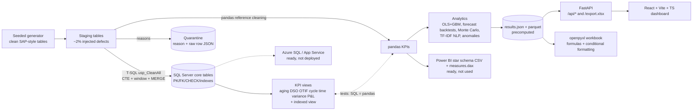

# Lekha - finance and order-to-cash analytics

Full-stack analytics platform for the finance function and the order-to-cash / procure-to-pay chain:
a seeded data generator, a **T-SQL layer on SQL Server**, Python analytics (regression, forecasting, Monte Carlo, classical NLP,
anomaly detection), a FastAPI backend, a React dashboard, an Excel export with live formulas, and Power BI / Azure readiness material.

> **All data is SYNTHETIC and SAP-STYLE.** Table names follow SAP conventions (`KNA1`, `VBAK`, `VBAP`, `LIKP`, `VBRK`, `BKPF`/`BSEG`, `LFA1`, `MARA`, `EKKO`/`EKPO`...)
> but the model is simplified and generated by `backend/lekha/generator.py`. There is **no real SAP data, no real company data and no connection to any SAP system.**

- Repo: https://github.com/HxrshRaj/Lekha
- Live demo: **not deployed yet** (needs a Render login; use the Blueprint: https://render.com/deploy?repo=https://github.com/HxrshRaj/Lekha)
- API docs: `/docs` on the running service (the disclaimer is part of the OpenAPI description)

## Architecture



The deployed service never needs SQL Server: it serves the files produced by `python -m lekha.pipeline`.
SQL Server is used to build and **verify** the T-SQL layer (locally in Docker and as a service container in CI).

## What is in the repo

| Path | Contents |
|---|---|
| `backend/lekha/generator.py`, `textgen.py` | Seeded generator: customers, vendors, materials with product variants (base + option codes), sales orders, deliveries, invoices, payments, purchase orders, goods receipts, GL with cost centres and budgets, dispute tickets. 3 years (2023-2025) |
| `backend/lekha/staging.py` | All-string staging tables with injected defects, plus the **pandas reference implementation** of the cleaning/quarantine rules |
| `sql/01..04_*.sql` | T-SQL: schema (keys, CHECKs, FKs, indexes), staging, cleaning procedures (`usp_Clean_*`, `usp_CleanAll`), KPI views, indexed view |
| `backend/lekha/kpis.py` | pandas implementation of every KPI that exists as a SQL view |
| `backend/lekha/{regression,forecast,simulation,nlp,anomaly}.py` | Analytics |
| `backend/lekha/api.py` | FastAPI app (KPIs, aging, DSO, OTIF, variance, P&L, forecast, simulation, NLP classify, anomalies, data quality, `/export.xlsx`) |
| `backend/lekha/excel.py` | Excel workbook with formulas; LibreOffice recalculation test |
| `frontend/` | React + Vite + TypeScript dashboard, Vitest tests |
| `powerbi/`, `azure/` | Readiness material (see limits) |
| `docs/perf_indexed_view.md` | Measured before/after of the indexed view |
| `.github/workflows/ci.yml` | SQL Server service container + T-SQL tests, backend tests, frontend tests and build |

## Run it

```bash
# backend: regenerate everything (about 1 minute) and test
cd backend && pip install -r requirements-dev.txt
python -m lekha.pipeline                  # writes backend/results/*
python -m pytest                          # no SQL Server needed for these
uvicorn lekha.api:app --port 8000

# frontend
cd frontend && npm ci && npm run dev      # proxies /api to :8000;  npm test; npm run build

# T-SQL layer on a real SQL Server (Docker)
docker run -d --name lekha-sql -e ACCEPT_EULA=Y -e "MSSQL_SA_PASSWORD=Lekha_Passw0rd!" -p 14330:1433 mcr.microsoft.com/mssql/server:2022-latest
cd backend && LEKHA_RUN_SQL=1 python -m pytest tests/test_sql_vs_pandas.py      # builds DB, runs procs, compares to pandas
python -m lekha.perf --scale 1.0                                                # indexed view before/after
```

## Results (all numbers below come from real runs; seed 42, scale 1.0, as-of 2025-12-31)

### Data
600,800 rows across 19 tables (core truth). Largest: `BSEG` 178,262, `BKPF` 87,349, `VBAP` 83,440, `LIPS` 83,116, `VBAK` 30,000, `VBRK` 29,839.
Staging (including injected duplicates) holds 333,657 rows in the 13 staged tables.

### Data quality and quarantine
Defects are injected per staged table (duplicates, nulls in required fields, negative amounts, bad/impossible dates, orphan keys, currency
mismatches): **5,485 injected defects = 1.64% of staging rows**. The cleaning step quarantines **19,654 rows (5.89%)** because rows whose parent was
rejected become orphans too (a cascade: 15,167 of the quarantined rows are `ORPHAN_KEY`, only 994 were injected as such).

| Reason | Quarantined rows |
|---|---|
| ORPHAN_KEY (incl. cascade) | 15,167 |
| DUPLICATE_KEY | 1,652 |
| NULL_REQUIRED | 1,336 |
| NEGATIVE_AMOUNT | 887 |
| BAD_DATE | 492 |
| CURRENCY_MISMATCH | 120 |

Reason priority is fixed: NULL_REQUIRED, DUPLICATE_KEY, BAD_DATE, NEGATIVE_AMOUNT, CURRENCY_MISMATCH, ORPHAN_KEY. Each rejected row is stored in `dbo.Quarantine` with the raw row as JSON.
Consequence worth knowing: a payment whose record is quarantined makes its invoice look **open**, so part of the 90+ bucket is a data-quality artefact.

### KPI definitions and values
| KPI | Definition | Value |
|---|---|---|
| Open receivables | invoices with `FKDAT <= as-of` and no payment on or before as-of | 3,062,052 (2,555 invoices) |
| Aging | days past due date `FAEDT`: Current (not yet due) / 0-30 / 31-60 / 61-90 / 90+ | 1,666,063 / 497,233 / 23,494 / 25,172 / **850,091 (27.8%)** |
| DSO (Dec 2025) | open AR at month end / invoiced in trailing 90 days x 90 | 74.48 days |
| OTIF | per order with a delivery: goods issue <= planned date AND delivered qty >= ordered qty | 73.05% (on time 82.42%, in full 88.49%) |
| Order-to-cash | payment date - order date, paid invoices | mean 53.3 d, median 52 d |
| Budget variance | actual opex - budget per cost centre and month, plus YTD | `vw_BudgetVariance` |
| P&L | revenue / COGS / opex from `BSEG` by account group | LTM revenue 12.89M, EBIT 0.83M, gross margin 34.0% |

### SQL vs pandas
Every view above has a pandas twin in `kpis.py`; `tests/test_sql_vs_pandas.py` loads the same staging data into SQL Server, runs `usp_CleanAll`
and compares: core row counts per table, the exact quarantined rows (table, sequence, reason), AR aging (counts, amounts, shares), AP aging,
DSO by month, OTIF by month, cycle time by month **including the median**, budget variance with YTD, and P&L.
**13 of 13 SQL tests pass at scale 0.1 and at scale 1.0 on SQL Server 2022 (Docker, local)**, tolerance 0.011 on money, exact on counts. CI repeats it on a service container.
The same file checks that constraints reject bad rows (CHECK, FK, PK), that `usp_CleanAll` is re-runnable, and that the indexed view equals the base-table aggregate.

### Indexed view (measured, `docs/perf_indexed_view.md`)
GL aggregation by period and account over 178,262 `BSEG` rows, warm cache, 30 runs, SQL Server 2022:
base-table scan + hash aggregate **87.1 ms median, 1,499 logical reads** vs the indexed view with `NOEXPAND` **15.0 ms, 4 logical reads** (about 6-8x faster wall-clock, 375x fewer reads; wall-clock includes client round trip, so the read count is the cleaner number). Plans are in the doc. Cost: the view is maintained on every `BSEG` write.

### Days-to-pay regression (`regression.py`)
Target: days from invoice date to payment (paid invoices). Train: invoices issued 2023-2024 (n = 17,799). Test: invoices issued 2025-01..09 (n = 7,038; later months are right-censored so they are excluded).

OLS (statsmodels), train R2 0.819 (adj. 0.818):

| Term | Coef (days) | p |
|---|---|---|
| terms (contract days) | 0.49 | <0.001 |
| dispute raised | 7.97 | <0.001 |
| log10 invoice amount | 2.94 | <0.001 |
| Q4 invoice (Nov-Dec) | 2.04 | <0.001 |
| prior mean days-to-pay of the customer (known at invoice date) | 0.57 | <0.001 |
| region AMER vs EMEA | -0.58 | <0.001 |
| region APAC vs EMEA | +1.42 | <0.001 |

Holdout error:

| Model | MAE (days) | RMSE | R2 |
|---|---|---|---|
| baseline: contract terms | 7.21 | 9.21 | 0.594 |
| baseline: train mean | 12.04 | 14.45 | 0.000 |
| OLS | 4.56 | 5.84 | 0.837 |
| Gradient boosting | **4.37** | 5.59 | 0.850 |

**Where it does not generalise:** the generator contains a regime change (APAC customers pay about 6 days later from 2025-07, which the 2023-24 training data cannot know about).
For APAC invoices issued 2025-07..09 OLS is biased by **-5.96 days** (GBM -6.18) and MAE rises from about 4.2 to 6.7-6.8 days; other regions stay near zero bias. Both models miss it equally.
These coefficients are recoveries of effects the generator put in, so they show the method works, not that real customers behave this way.

### Forecasting (`forecast.py`)
Weekly series, rolling-origin backtest (first training window 104 weeks, 4-week horizon, step 4, **12 folds**). WAPE / MAPE:

| Cash-in (USD per week) | WAPE | MAPE |
|---|---|---|
| **gradient boosting (lags + seasonal lag + Fourier)** | **10.1%** | 10.1% |
| moving average (4 wk) | 11.0% | 11.1% |
| naive | 11.3% | 11.7% |
| ETS (damped trend + 52-week seasonality) | 13.8% | 13.8% |
| seasonal naive | 14.0% | 13.9% |

| Demand (units per week) | WAPE | MAPE |
|---|---|---|
| **ETS** | **8.8%** | 8.9% |
| gradient boosting | 10.0% | 10.4% |
| seasonal naive | 10.6% | 10.2% |
| naive | 13.2% | 13.7% |
| moving average (4 wk) | 14.0% | 14.6% |

Where models lose to naive: for **cash-in, ETS and seasonal naive are both worse than naive** (13.8% and 14.0% vs 11.3%), and the winning model beats naive by only 1.2 points of WAPE. The demand series has strong seasonality built in by the generator, so seasonal models do better there.

### Monte Carlo simulation (`simulation.py`)
**90-day cash collection** on the 2,555 invoices open at the as-of date (3.06M): each invoice's days-to-pay is bootstrapped from the customer's paid history (region pool if fewer than 15 paid invoices),
conditioned on the invoice still being unpaid; a never-pays probability of 3.2% (estimated from invoices 150-400 days old that are still open) and a common payment-speed shock per run (sd 2.0 days, from monthly variation) are added.
**5,000 runs, seed 7: 90-day cash-in p5 / p50 / p95 = 1.86M / 2.07M / 2.10M** (median 67% of open AR; 799 invoices are too old to have any collectable history and contribute nothing).
Convergence of the mean (std. error): 100 runs 7,516; 500 runs 3,417; 1,000 runs 2,346; 5,000 runs 1,073.
The range is narrow because the generator's payment behaviour is well-behaved; the band covers only invoices already open, not future billing.

**Safety stock / stock-out**, 5 materials spread across the demand ranking, **20,000 runs, seed 11**, 95% service target; lead times bootstrapped from PO to goods-receipt history, daily demand bootstrapped over each simulated lead time:

| Material | mean lead (d) | mean daily demand | SS formula | SS simulated | stock-out prob at formula reorder point |
|---|---|---|---|---|---|
| B0004-BLU-L | 34.0 | 17.8 | 368 | 410 | 6.5% |
| B0012-BLU-S | 12.6 | 17.3 | 155 | 177 | 6.9% |
| B0010-RED-M | 12.8 | 7.9 | 86 | 98 | 6.9% |
| B0025-GRN-M | 7.5 | 4.1 | 38 | 44 | 6.7% |
| B0033-BLU-S | 35.6 | 2.1 | 64 | 71 | 6.7% |

The normal-approximation formula gives a stock-out probability of 6.5-6.9% against the 5% target (std. error about 0.17 points at 20,000 runs); simulation needs 11-15% more safety stock because demand is lumpy and skewed.

### NLP (`nlp.py`, classical, no pretrained models)
Text is **synthetic** (templates with typos, abbreviations, dropped words, filler phrases, 15% mixed-signal tickets and 4% label noise). 2,440 tickets, 7 classes, stratified 75/25 split (train 1,830, test 610).
TF-IDF (1-2 grams) + logistic regression: **accuracy 89.3%, macro F1 0.887** (majority-class baseline 20.3%).

| Class | Precision | Recall | F1 | n |
|---|---|---|---|---|
| pricing_error | 0.914 | 0.944 | 0.929 | 124 |
| short_shipment | 0.899 | 0.916 | 0.907 | 107 |
| late_delivery | 0.910 | 0.900 | 0.905 | 90 |
| payment_not_applied | 0.887 | 0.910 | 0.899 | 78 |
| tax_vat_query | 0.887 | 0.900 | 0.894 | 70 |
| damaged_goods | 0.897 | 0.836 | 0.865 | 73 |
| duplicate_invoice | 0.831 | 0.794 | 0.812 | 68 |

Confusion matrix (rows = true class, columns = predicted; class order: pricing_error, short_shipment, damaged_goods, late_delivery, duplicate_invoice, payment_not_applied, tax_vat_query):
`[[117,2,2,1,2,0,0],[0,98,2,1,3,2,1],[4,3,61,1,1,2,1],[1,1,0,81,2,1,4],[4,4,0,3,54,3,0],[0,1,1,2,1,71,2],[2,0,2,0,2,1,63]]`.
NMF topic modelling (7 topics, no labels) gives top terms per topic and a topic-vs-label purity of 0.56, i.e. unsupervised topics only partly recover the categories. Per-class keywords come from the logistic coefficients. The dashboard has a "try it" box that calls `/api/nlp/classify`.

### Anomaly detection (`anomaly.py`)
Injected: invoice values inflated 4-9x (298 survive cleaning) and payments paid at 0.4x or 1.8x of the invoice (155 survive).

| Invoice detector | Flagged | True positives | Recall | Precision |
|---|---|---|---|---|
| robust z-score per customer (> 3.5) | 31 | 14 | 4.7% | 45% |
| IQR fence on log amount | 59 | 43 | 14.4% | 73% |
| Isolation forest on amount features | 576 | 107 | 35.9% | 19% |
| Isolation forest incl. 3-way-match ratio | 576 | 183 | 61.4% | 32% |
| 3-way match rule (invoice vs delivered qty x order price, tolerance 5%) | 418 | 262 | 87.9% | 63% |
| union of z-score, isolation forest and 3-way match | 911 | 280 | **94.0%** | 31% |

Amount-only statistics barely work because customers' invoice sizes already vary a lot; the control that works is the finance one (three-way match), which is **optimistic** here because the injected anomaly is exactly a value mismatch.
Orders that lost a line item to quarantine are excluded from the match test (their expected value is wrong). Payments: the rule `|paid/invoice - 1| > 5%` finds 155 of 155 (100% recall and precision, same caveat); isolation forest finds 8 of 155 (5%).

### Tests
| Suite | Result |
|---|---|
| pytest, no SQL Server (generator determinism, quarantine rules, KPIs, regression, forecast, simulation, NLP, anomalies, API, Excel) | 28 collected without SQL Server: 27 pass locally and the 28th (LibreOffice recalculation of the Excel workbook) runs in CI only |
| pytest, T-SQL vs pandas (needs SQL Server) | 13 passed (local Docker SQL Server 2022, scale 0.1 and 1.0) |
| Vitest + React Testing Library (disclaimer, loading, error + retry, empty, tables, NLP try-it success and failure, export link) | 8 passed |
| GitHub Actions | all 3 jobs green on commit 94925b9 (SQL Server 2022 service container, backend incl. LibreOffice, frontend) |

LibreOffice is not installed on the author machine, so the Excel recalculation test was not run locally; it runs in CI (apt `libreoffice-calc`) where the job passed.

## Honest limits

- **Synthetic, SAP-style, not SAP.** Simplified tables generated by code. No real SAP data, no connection to SAP, no real BAPIs/IDocs, and the schema is far simpler than the real thing.
- **Optimistic accuracy.** Forecast, regression and NLP are fitted on data produced by the same structure the models learn (payment effects, seasonality and ticket templates are built into the generator; labels have only 4% noise). Treat the scores as proof the pipeline works, not as expected real-world accuracy. The anomaly rule that reaches 88-100% recall detects the very mismatch that was injected.
- **SQL Server status.** The T-SQL was run for real on SQL Server 2022 in Docker on the author's Windows machine (13/13 comparison tests, scale 0.1 and 1.0) and is run again in CI as a service container. It is not running in production anywhere, and the **deployed demo does not use SQL Server** (it serves precomputed files).
- **Power BI: not used.** The star-schema export and `measures.dax` are ready but the DAX has never been executed in Power BI Desktop and there is no `.pbix`.
- **Azure: not deployed by me.** `azure/` contains a guide, a script and config for Azure SQL Database and App Service; none of it has been run on Azure.
- **Not production scale.** About 0.6M rows, single machine, batch pipeline, no auth, no incremental loads, no data lineage tooling.
- **Single currency.** Everything is USD; the `CURRENCY_MISMATCH` rule only checks a document currency against the customer master.
- **Simplified finance.** One payment per invoice (no partials or credit notes), no tax lines, GL postings are derived from the true documents (so GL revenue includes invoices whose billing record was later quarantined), and the cash simulation only covers already-open invoices.
- **Regime change is deliberate.** The APAC slowdown in 2025 is planted to show a model failing out of time; it is not a finding about real customers.
